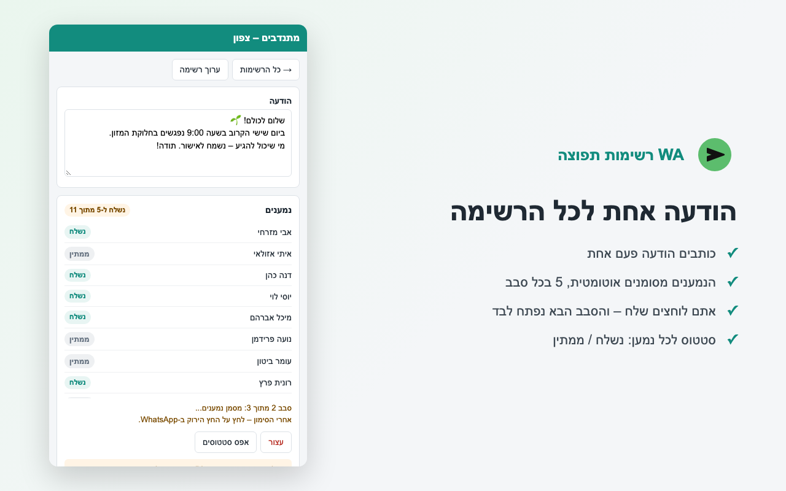

<p align="center">
  
</p>

<h1 align="center">WA רשימות תפוצה · WA Broadcast Lists</h1>

<p align="center">
  Chrome extension for WhatsApp Web: broadcast lists for contacts <b>and groups</b>, with text, images and videos.<br>
  The extension prepares everything – <b>you always click Send yourself</b>.
</p>

<p align="center">
  <a href="https://www.tools-mishmish.com/wa-broadcast-lists.html">Project page</a> ·
  <a href="https://www.tools-mishmish.com/privacy-policy-wa-broadcast-lists.html">Privacy policy</a> ·
  <a href="#עברית">עברית</a>
</p>

<p align="center">
  
</p>

## English

### What it does

- **Broadcast lists** built from your WhatsApp contacts and groups (scan once, pick members, save).
- **Text messages in rounds of 5** – the extension opens WhatsApp Web's own "Send to" dialog with your message and ticks up to 5 recipients; you click WhatsApp's send button and the next round opens automatically.
- **Images and videos** – the first recipient gets the file with your message as the caption, then the extension forwards that same message to the rest, 5 per click. WhatsApp doesn't label your own forwarded messages as "Forwarded". With several files it goes one recipient at a time.
- Per-recipient status (sent / pending / not found), resume where you stopped, alphabetical sorting, search, backup/import to a file.
- A button in WhatsApp's side menu opens and closes the side panel. The extension is active only on `web.whatsapp.com`.

### Privacy

No server, no analytics, no network requests. Lists, contact names and messages are stored only in `chrome.storage.local` in your browser. Attached files stay in memory and are passed only to WhatsApp Web in the same browser.

### Install from source

1. Clone this repository.
2. Open `chrome://extensions`, enable **Developer mode**, click **Load unpacked** and pick the `extension/` folder.
3. Open [web.whatsapp.com](https://web.whatsapp.com) and click the green button in WhatsApp's left menu.

### How it works (for developers)

Plain JavaScript, Manifest V3, no build step and no dependencies.

```
extension/
  manifest.json      permissions: sidePanel, storage; host: web.whatsapp.com only
  background.js      enables the side panel only on WhatsApp tabs; opens/closes it from the menu button
  sidepanel.html/js  the UI: lists, editing, sending, backup
  content.js         runs inside WhatsApp Web: menu button, contact scan, ticking recipients,
                     attaching media, forwarding
  icons/
assets/              logo sources (SVG + PNG)
store/               Chrome Web Store listing texts, screenshots and promo images
packaging/           packaging script and manual-install instructions
```

- Text rounds use `https://web.whatsapp.com/send?text=…` (the same dialog `wa.me/?text=…` opens) and tick recipients in it.
- WhatsApp Web's markup changes from time to time. All selectors live in the `SELECTORS` / `CHAT` objects at the top of `extension/content.js` – that's the first place to look when something stops working.
- `npm run package` builds `dist/wa-broadcast-lists-store.zip` (for the Chrome Web Store) and `dist/wa-broadcast-lists.zip` (manual install, includes `install.txt`). Bump `version` in `extension/manifest.json` before each release.

### Contributing

Issues and pull requests are welcome – especially selector fixes after WhatsApp Web updates. Please keep the core rule: **the extension never clicks Send on its own.**

### Disclaimer

This project is not affiliated with, endorsed by, or sponsored by WhatsApp or Meta. WhatsApp is a trademark of WhatsApp LLC. Sending many messages quickly can get a number restricted by WhatsApp – use it responsibly and only with people who expect your messages.

---

<div dir="rtl">

## עברית

תוסף Chrome ל-WhatsApp Web ששולח את אותה הודעה להרבה אנשים **וגם להרבה קבוצות**, כולל תמונות וסרטונים. התוסף מכין הכול – **את "שלח" לוחצים בעצמכם**.

### מה יש

- **רשימות תפוצה** מאנשי הקשר והקבוצות: סורקים פעם אחת, מסמנים ושומרים. מיון לפי א"ב, המסומנים למעלה ומספרי טלפון בסוף.
- **טקסט בסבבים של 5**: התוסף פותח את חלון "שלח אל" של WhatsApp עם ההודעה ומסמן עד 5 נמענים. לוחצים על החץ הירוק, והסבב הבא נפתח לבד.
- **תמונות וסרטונים**: הנמען הראשון מקבל את הקובץ עם ההודעה ככיתוב, ואז התוסף מעביר את אותה הודעה לשאר – 5 בכל לחיצה. הודעה שכתבתם בעצמכם ומעבירים לא מסומנת "הועברה". עם כמה קבצים – נמען אחד בכל פעם.
- סטטוס לכל נמען, המשך מאותה נקודה, סריקה עם ספירה לאחור ונעילת מסך, גיבוי וייבוא לקובץ.
- כפתור בתפריט הצד של WhatsApp שפותח וסוגר את הפאנל. התוסף פעיל רק ב-web.whatsapp.com.

### פרטיות

אין שרת ואין שליחת מידע לשום מקום. הרשימות, השמות וההודעות נשמרים רק בדפדפן (`chrome.storage.local`). קבצים מצורפים נשמרים רק בזיכרון ומועברים רק ל-WhatsApp Web באותו דפדפן.

### התקנה מהקוד

1. מורידים את ה-repo.
2. פותחים את `chrome://extensions`, מפעילים **Developer mode**, לוחצים **Load unpacked** ובוחרים את התיקייה `extension/`.
3. פותחים את [web.whatsapp.com](https://web.whatsapp.com) ולוחצים על הכפתור הירוק בתפריט הצד של WhatsApp.

אחרי שינוי בקוד: ↻ על התוסף ב-`chrome://extensions` ורענון של WhatsApp Web.

### פיתוח

- JavaScript רגיל, Manifest V3, בלי build ובלי תלויות.
- **המבנה של WhatsApp Web משתנה מדי פעם.** כל הסלקטורים נמצאים באובייקטים `SELECTORS` ו-`CHAT` בראש `extension/content.js` – זה המקום הראשון לבדוק כשמשהו מפסיק לעבוד.
- `npm run package` בונה חבילה לחנות וחבילה להתקנה ידנית ב-`dist/`. לפני כל גרסה מעלים את `version` ב-`extension/manifest.json`.
- טקסטים ותמונות לחנות Chrome נמצאים ב-`store/` (ראו `store/listing.md`).

### מגבלות ידועות

- נמען נמצא לפי השם המדויק שלו ב-WhatsApp. שני אנשי קשר עם אותו שם ייחשבו כאחד.
- "נשלח" נקבע לפי לחיצה על כפתור השליחה. אם החלון נסגר בלי הלחיצה, השליחה נעצרת.
- Chrome לא מאפשר לפתוח פאנל צד בלי לחיצה, ולכן צריך ללחוץ על הכפתור פעם אחת.
- לא לסגור את הפאנל בזמן שליחה.

### תרומה לפרויקט

Issues ו-Pull Requests יתקבלו בשמחה – במיוחד תיקוני סלקטורים אחרי עדכונים של WhatsApp. הכלל היחיד: **התוסף אף פעם לא לוחץ "שלח" בעצמו.**

### הבהרה

הפרויקט אינו קשור ל-WhatsApp או ל-Meta ואינו מאושר על ידן. שליחה של הרבה הודעות מהר עלולה לגרום ל-WhatsApp להגביל את המספר – השתמשו באחריות, ורק מול אנשים שמצפים להודעות מכם.

</div>

## License

[MIT](LICENSE) © 2026 Michael Lev ([mishmish](https://www.tools-mishmish.com))
